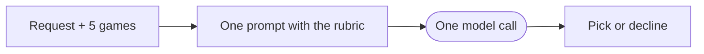
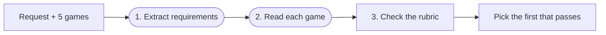

# Project 1: single call vs compound

Team: Laura Jimena Tagle Muñoz and Paola Larissa Hernandez Llamas.

Both systems take one request and five candidate games, and return the one game that meets every requirement
in [RUBRIC.md](RUBRIC.md), or decline. This README covers how to run them, how well they do, where the compound
system fails, and what we changed after the checkpoint.

## Summary

**Problem.** A single model call often misses one of a request's requirements: it picks a game that breaks one,
or declines although a game fits.

**Approach.** The compound system splits the work into a pipeline of steps: one model step extracts the
requirements, another reports facts about each game, and plain Python applies the rubric and picks the game. When
an answer is wrong, we can trace which step went wrong first, and fix that step.

| | Single-call | Compound |
|---|---|---|
| **Official checkpoint** (50 requests) | 34/50 | 44/50 |
| **Public, checkpoint version** (150 requests) | 93/150, 97/150 | **132/150, 133/150** |
| **Public, final version** (150 requests) | 93/150, 97/150 | **140/150, 142/150** |
| **Feedback, final version** (50 unseen requests) | 29/50, 28/50 | 46/50, 46/50 |
| Cost per request, checkpoint version | $0.00027–$0.00042 | $0.00176 |
| Cost per request, final version | $0.00027–$0.00042 | $0.00054–$0.00057 |
| Time per request, checkpoint version | 0.3 s | 3.5 s |
| Time per request, final version | 0.3 s | 1.05 s |

*Checkpoint version:* the compound system we submitted for the checkpoint (v4 plus a crash fix, commit
`ed925a4`); the official score is the course app's run of it. *Final version:* v10, `systems/compound.py`. The
single-call system hasn't changed since the checkpoint. Public scores come from 2 runs each, feedback scores from 2
course-app runs.

**Selected change: keep a correctly extracted mode** (cooperative or competitive). Mode dropped was the largest
group of the checkpoint version's failures: the model extracted the mode correctly, but a Python check discarded
it whenever the model's quote of the request wasn't word for word. Compared with the same code without the
change (v7), the public score went from 138 and 136 to 140 and 142 (2 runs each), every request of the group is
right, and no right answer broke because of it. On the unseen feedback requests it made no measurable difference: v6, before it, also scored 46/50.
[Details](#the-change-keep-a-correctly-extracted-mode).

**Also since the checkpoint:** an earlier fix for rule-difficulty clues (public 132 and 133 → 137 and 139,
[details](#earlier-change-rule-difficulty-clues-must-talk-about-the-rules)), and fewer model calls, which cut the
cost and time per request by about 70% without changing any answer ([details](#cost-fewer-model-calls)).

All numbers except the course app's come from runs saved in `runs/`; the [results](#results) section lists every
run.

**Terms used below:**

| Term | Meaning |
|---|---|
| `extract_requirements` | The model step that reads the request and lists its requirements |
| `decide` | The model step that reports facts about one game, such as its player count or whether it has fighting |
| Mode | Whether the request asks for a cooperative or a competitive game |
| Mode dropped | The model extracted the mode correctly, but a Python check then discarded it |
| Step accuracy | How often one model step's output matches our hand labels, field by field |
| Swapextract run | A run with our extraction labels in place of `extract_requirements`, to measure `decide` alone |
| Offline replay | Rerunning only the Python part on saved model outputs, with no new model calls |
| Rerun | Our own run of a version on the same requests, as opposed to the official course run |

## How to run

You need Python 3.10 or newer. From a clean checkout:

```bash
python3 -m venv .venv
. .venv/bin/activate
pip install -e ".[test]"
python -m pytest
```

Set the two variables from the course app's Project 1 page in the same terminal. Never commit the token.

```bash
export P1_ENDPOINT=...   # from the Project 1 page
export P1_TOKEN=...      # your own token
```

Run a system and score the run:

```bash
python -m p1.run systems/single.py   --requests data/public.jsonl --out runs/<new-folder>
python -m p1.run systems/compound.py --requests data/public.jsonl --out runs/<new-folder>
python score.py runs/<new-folder>

# Checkpoint requests: score against their own answer file.
python -m p1.run systems/compound.py --requests data/checkpoint_requests.jsonl --out runs/<new-folder>
python score.py runs/<new-folder> --answers data/checkpoint_answers.jsonl
```

Each `--out` folder must be new, or add `--force`. A run on the hidden labeling requests (`data/labeling.jsonl`)
can't be scored with `score.py`, because their answers aren't public.

## Files

| File | What it is |
|---|---|
| `systems/single.py` | The single-call system: one prompt with the rubric rules, one model call. |
| `systems/compound.py` | The compound system we submit (v10): fewer model calls plus the mode change. Runs made before we renamed it call it `compound-2.py`. |
| `systems/compound-v6.py` | v6: the same steps, but `decide` runs on all five games and there's no mode change. Kept to compare against and to measure step accuracy, since it evaluates every labeled input. |
| `systems/compound-checkpoint.py` | The compound system exactly as submitted for the checkpoint (commit `ed925a4`), kept to measure against. |
| `score.py` | Our scorer. |
| `runs/` | The saved output of our runs; see the note below. |

**Run folders.** The saved output of every run this README reports, plus other runs from development that it doesn't cite, named `<version>-<requests>-run<N>`: version `single`, `checkpoint` (commit `ed925a4`), `v5`, `v6`, `v7` (v6 with fewer calls, never committed on its own) or `v10` (final); requests `public`, `public10` (first 10), `checkpoint`, `practice` or `labeling`; `-swapextract` when our extraction labels replaced the model's. Every run used gpt-4o-mini-2024-07-18. `runs/old/` holds early drafts and runs the server outage broke, which we don't report.

## Our systems

**Single-call** (`systems/single.py`). One prompt asks the model to label each game ACCEPT, BREAK or CAN'T TELL
against the rubric and to pick an accepted game or decline.



**Compound** (`systems/compound.py`). Two model steps, then plain Python for every rubric rule that can be
checked from data:

1. `extract_requirements` (1 call): reads the request and returns the requirements: players, maximum minutes,
   the youngest player's age, mode (cooperative or competitive), complexity (light, medium or heavy) and things to
   avoid (fighting, violence, horror, timer, player elimination). Wishes are kept separately and never checked.
   Python keeps a mode or complexity only if the request backs it outside a wish (see
   [the mode change](#the-change-keep-a-correctly-extracted-mode)).
2. `decide` (1 call per game): reads one game and reports facts, not verdicts: the player range and play time
   when the card lacks them, whether the description says the rules are easy or complex, and whether each avoided
   feature is present. Each fact taken from the description must come with a quote that Python finds in the
   description.
3. Python applies the rubric: player range, play time, age and mode from the card; complexity from the weight,
   game types and the description clues, as in RUBRIC.md section 3; avoided features from the card's tags plus
   `decide`'s answer. It goes through the games in order and picks the first that passes every check, or
   declines. It calls `decide` only for a game whose card doesn't already rule it out, and stops at the first
   acceptable game.



Steps 1 and 2 are model calls (rounded boxes); step 3 is plain Python. Several games can pass the checks; the
system picks the first one, in order A to E, and declines if none passes.

A reply that doesn't fit its type is retried once, within the limit of 10 calls per request, and a game still
without a valid reply is never picked, so every request gets an answer. We added this after a reply with 0 players
left P048 without an answer in an early submission (Gradescope check 7); it was already in the checkpoint version.

## Results

Every run below finished with 0 failed requests. Cost and time are per request.

### Public requests (150)

| System | Run | Score | Cost | Time | Calls |
|---|---|---|---|---|---|
| Single-call | `runs/single-public-run2` | 93/150 | $0.00042 | 0.33 s | 1.0 |
| Single-call | `runs/single-public-run3` | 97/150 | $0.00027 | 0.30 s | 1.0 |
| Compound, checkpoint version | `runs/checkpoint-public-run1` | 132/150 | $0.00176 | 3.54 s | 6.0 |
| Compound, checkpoint version | `runs/checkpoint-public-run2` | 133/150 | $0.00176 | 3.45 s | 6.0 |
| Compound, v6 (`compound-v6.py`) | `runs/v6-public-run1` | 137/150 | $0.00182 | 3.37 s | 6.0 |
| Compound, v6 (`compound-v6.py`) | `runs/v6-public-run2` | 139/150 | $0.00184 | 3.26 s | 6.0 |
| Compound, v7: fewer calls, no mode change | `runs/v7-public-run1` | 138/150 | $0.00057 | 1.04 s | 2.1 |
| Compound, v7: fewer calls, no mode change | `runs/v7-public-run2` | 136/150 | $0.00054 | 1.05 s | 2.1 |
| Compound, v10, final (`compound.py`) | `runs/v10-public-run1` | 140/150 | $0.00057 | 1.05 s | 2.1 |
| Compound, v10, final (`compound.py`) | `runs/v10-public-run2` | 142/150 | $0.00054 | 1.05 s | 2.1 |

### Checkpoint requests (50)

| System | Run | Score | Cost |
|---|---|---|---|
| Single-call | official checkpoint run (course app, held-out set 2) | 34/50 (68%) | $0.0004 |
| Compound, checkpoint version | official checkpoint run (course app, held-out set 2) | 44/50 (88%) | $0.0018 |
| Single-call (our rerun) | `runs/single-checkpoint-run1` | 34/50 | $0.00042 |
| Compound, checkpoint version (our rerun) | `runs/checkpoint-checkpoint-run1` | 45/50 | $0.00180 |
| Compound, v6 (`compound-v6.py`) | `runs/v6-checkpoint-run1` | 45/50 | $0.00184 |
| Compound, v6 (`compound-v6.py`) | `runs/v6-checkpoint-run2` | 46/50 | $0.00180 |
| Compound, v7: fewer calls, no mode change | `runs/v7-checkpoint-run1` | 45/50 | $0.00056 |
| Compound, v10, final (`compound.py`) | `runs/v10-checkpoint-run1` | 46/50 | $0.00055 |
| Compound, v10, final (`compound.py`) | `runs/v10-checkpoint-run2` | 46/50 | $0.00051 |

The compound system does clearly better than the single-call system, at 1.3 to 2 times its cost per request
(4 to 7 times for v6); the single-call system's cost varied between its two runs. Two runs of the same version
differ by up to 2 requests out of 150, because the model's answers vary; we treat differences that small as noise.

### Feedback requests (50, unseen)

The course app runs both systems of a Gradescope submission on 50 requests we can't see, and reports only the
scores.

| Submission | Version | Single-call | Compound |
|---|---|---|---|
| Wed 14 Oct, 18:45 | v6 | 29/50 | 46/50 |
| Thu 15 Oct, 17:56 | v10 | 29/50 | 46/50 |
| Fri 16 Oct, 00:08 | v10 | 28/50 | 46/50 |

Both v10 submissions run the same code (commits `34afa19` and `963bb37`; the second changed only the README).

The single-call system never changed, and its score still moved between 28 and 29: the same run-to-run variation
as on the public requests.

To re-score any run above: `python score.py runs/<folder>`, adding `--answers data/checkpoint_answers.jsonl` for
a checkpoint run.

## Labels and step accuracy

We labeled every input of both model steps on the 10 public practice requests and the 10 hidden labeling
requests (`labels/`). With our labels in place of both model steps, the system answers all 10 practice requests
right (Gradescope label check).

Step accuracy on the 10 hidden labeling requests, measured with v6. The final version's steps are the same: its
`decide` prompt and checks are identical, and its extraction differs only in keeping a mode more often, a field v6
already got right on all 10.

| Step | All&nbsp;correct | Per field |
|---|---|---|
| `extract_requirements` | 9/10 | complexity 9/10, all others 10/10 |
| `decide` | 43/50 | easy rules 0.96, complex rules 0.98, avoid 0.94, all others 0.98 or more |

*All correct* counts the calls in which every labeled field matches our label. Runs: `runs/v6-labeling-run1`
(normal run) for `extract_requirements`, and `runs/v6-labeling-swapextract-run1` (our extraction labels swapped
in) for `decide`.

We measure `decide` with our extraction labels swapped in (`--override extract_requirements=...`), so that its
inputs match the labeled ones; in a normal run, free-text fields such as quotes and wishes make them differ.

Disagreements we found while checking:

- The one extraction "miss", L03, is a wrong label: the request never asks for a complexity level, and the model
  is right to return none.
- `decide` still makes real mistakes on avoided features read from the description, in both directions: it
  called a cooperative game's "win or lose as a group" player elimination (L03), and missed "everyone
  simultaneously tries to grab" as a timer (L04).

## Where it fails

**Official checkpoint result** (course app, held-out set 2): single-call **34/50**, compound **44/50**, from our
checkpoint submission (`systems/compound-checkpoint.py`, commit `ed925a4`, run by the course on Tue 13 Oct, 19:06).
The course app gives only these scores, **not which requests were wrong**.

**Our rerun of the same code** on the same 50 requests: single-call **34/50** (`runs/single-checkpoint-run1`),
compound **45/50** (`runs/checkpoint-checkpoint-run1`). The failure analysis below uses **the rerun's five
failures**. They are not the official wrong requests: answers vary between runs of the same code, so the official
run's six failures may include different requests.

### Failures in our rerun (`runs/checkpoint-checkpoint-run1`)

| Request | What went wrong | Group |
|---|---|---|
| H1-016 | Call of Cthulhu: The Card Game is a right medium game, but `decide` called its rules complex from "a solid game experience, full of strategy and excitement", so Python rejected it and declined | Wrong rule-difficulty clue |
| H1-088 | Techno Bowl is a right medium game, but `decide` quoted "complex rules" from "without the need for complex rules", dropping the "without", so Python rejected it and declined | Wrong rule-difficulty clue |
| H1-082 | "play against each other": the model extracted competitive, but its quote of the request wasn't word for word, so the mode was discarded and a cooperative game was picked | Mode dropped |
| H1-096 | "play against each other": same as H1-082, and a cooperative game was picked | Mode dropped |
| H1-030 | The Voting Game's card has no player count; `decide` reported 3–10 players from "for up to 10 players", inventing the minimum, so the game counted as fitting 6 players | Player count from the description |

| Group | Count |
|---|---|
| Mode dropped | 2 |
| Wrong rule-difficulty clue | 2 |
| Player count from the description | 1 |

We checked each diagnosis by replacing the first wrong output and rerunning only the Python part on the recorded
outputs, with no model calls. Each single correction turns the wrong answer into a right one:

| Request | First wrong output | Corrected to | Pick before → after |
|---|---|---|---|
| H1-016 | `decide` on D: complex rules true | false | decline → D (right) |
| H1-088 | `decide` on D: complex rules true | false | decline → D (right) |
| H1-082 | `extract_requirements`: mode none | competitive | A → B (right) |
| H1-096 | `extract_requirements`: mode none | competitive | D → E (right) |
| H1-030 | `decide` on A: players 3–10 | not given | A → C (right) |

Five failures are too few to rank the groups, so we grouped the same version's failures on the public requests
too (`runs/checkpoint-public-run1`: 18 wrong, `runs/checkpoint-public-run2`: 17 wrong):

| Group | Public run 1 | Public run 2 | Checkpoint | Requests |
|---|---|---|---|---|
| Mode dropped | 5 | 5 | 2 | P029, P039, P053, P116, P143, H1-082, H1-096 |
| Wrong rule-difficulty clue | 3 | 5 | 2 | P059, P067, P076, P108, P146, H1-016, H1-088 |
| Avoid wrong | 5 | 2 | 0 | P022, P068, P071, P125, P150 |
| Complexity clue or card missed | 3 | 3 | 0 | P074, P135, P145 |
| Other | 2 | 2 | 1 | P023, P043, H1-030 |

Mode dropped is the largest group, and wrong rule-difficulty clues the second largest.

## What we changed

We made one change for each of the two largest groups, and one change to cost: v6 fixed the rule-difficulty
clues, v7 is v6 with fewer model calls, and v10, our final system, adds the mode change to v7.

### The change: keep a correctly extracted mode

**Group it addresses:** mode dropped, the largest group of the checkpoint version: 12 failures across its three
runs (5 and 5 public, 2 in the checkpoint rerun; P029, P039, P053, P116, P143, H1-082, H1-096).

**What goes wrong.** `extract_requirements` returns the mode together with a quote from the request as evidence.
A Python check, `explicit_requirement`, keeps the mode only if that quote appears in the request word for word.
The model gets the mode right but paraphrases the quote: for "My husband and I want a game for the two of us to
play against each other" (H1-082) it quoted "we want a game for the two of us to play against each other". The
check then sets the mode to none, Python stops checking cooperative against competitive, and a game with the wrong
mode can be picked: a cooperative kids' game for H1-082, which asked for play against each other. The model is
right; the Python check throws its answer away.

**The change** (`systems/compound.py`, in `extract_requirements`): when the quote doesn't match word for word,
the new function `mode_in_request` looks at the request itself. It keeps the model's mode if a sentence of the
request contains the rubric's wording for that mode and isn't a wish:

- cooperative: "against the game", "as one team", "team up", "cooperative", "co-op";
- competitive: "head to head", "against each other", "against one another", "competitive", "free for all";
- a sentence with "would be nice", "bonus points", "we love" and the like is a wish and doesn't count, as before.

So "It would be nice if the game can be played either PvP or co-op" (H1-030) still gives no mode, and "play
together" alone still doesn't mean cooperative, as the rubric says. The change only keeps a mode the model
extracted; it never adds one.

**Prediction**, written before running anything:

1. **Requests it should fix:** public P029, P039, P053, P116, P127, P143; checkpoint H1-067, H1-082. In each, the
   model extracted the right mode and the quote check discarded it.
2. **Currently right answers to check again:** every request with a mode requirement, e.g. P031, P090, P101, P129,
   P134, so the fix doesn't start keeping a mode that the request only wishes for.
3. **Keep it if** the average of 2 public runs rises by at least 3, none of the rechecked requests turns wrong, and
   the feedback score doesn't drop. Otherwise we report that it didn't hold up.

**Offline check, before any new run.** The `decide` prompt doesn't use the mode, so v6's recorded outputs stay
valid when only the mode changes. Replaying v6's four saved runs (`runs/v6-public-run1`, `runs/v6-public-run2`,
`runs/v6-checkpoint-run1`, `runs/v6-checkpoint-run2`) through the new code, with no model calls, raised the scores
from 137 to 143, 139 to 144, 45 to 47 and 46 to 48, and no right answer became wrong.

**Real runs.** We compare v10 with v7, the same low-cost code without the change (see
[Cost](#cost-fewer-model-calls)):

| | v7, before the change | v10, after the change |
|---|---|---|
| Public (150), 2 runs | 138, 136 | 140, 142 |
| Checkpoint (50) | 45 | 46, 46 |
| Feedback (50 unseen) | 46 (v6) | 46, 46 |
| Cost per request | $0.00056 | $0.00055 |
| Time per request | 1.05 s | 1.05 s |

Runs: v7 in `runs/v7-public-run1`, `runs/v7-public-run2` and `runs/v7-checkpoint-run1`; v10 in
`runs/v10-public-run1`, `runs/v10-public-run2`, `runs/v10-checkpoint-run1` and `runs/v10-checkpoint-run2`. For
feedback, v6 stands in for v7, which was never submitted; v6 makes the same decisions as v7.

**Compared with the prediction, request by request:**

1. *Requests it should fix:* all six public requests of the group (P029, P039, P053, P116, P127, P143) are right
   in both runs after the change; before, P029, P039, P053, P116 and P143 were wrong in both runs. On the
   checkpoint requests, H1-067 and H1-096 turned right; H1-082 was already right in the run before.
2. *Rechecked right answers:* P031, P090, P101, P129 and P134 stay right in both runs.
3. *Answers that turned wrong:* five requests that were right in both runs before are wrong in one run after.
   We checked each trace; none comes from the change, because in four of them the request has no mode
   requirement and nothing about the mode changed:

   | Request | First wrong output | Group |
   |---|---|---|
   | P006 | `decide` said Senjutsu: Battle For Japan has horror | Avoid wrong |
   | P141 | `decide` said Warhammer 40,000 and Fief have player elimination | Avoid wrong |
   | H1-052 | `decide` said Mahé has fighting | Avoid wrong |
   | P019 | `decide` gave 1822PNW, whose card has no player count, 2 players, quoting just "2", which the quote check found inside "1822" | Player count from the description |
   | P098 | The mode was kept, rightly ("go head to head"), but the model paraphrased the complexity quote ("I want…" for "we want…"), so the same word-for-word check dropped "heavy", and a light game was picked | Quote check, complexity |

   These are the run-to-run variation we also see between two runs of unchanged code. P098 shows that the
   word-for-word quote check also drops complexity requirements now and then; the change fixed it only for mode.

**Decision: we keep the change.** The average of the two public runs rose from 137 to 141, more than the 3 we set
as the threshold; every request of the group is right in both runs; none of the rechecked answers turned wrong,
and the five new failures come from other groups. On the unseen feedback requests the change made no measurable
difference (46 before, 46 and 46 after): the score didn't drop, which our prediction required, but it didn't rise
either, so the gain we can show is on the public and checkpoint requests only.

**What's still wrong** in the two final public runs (8 and 10 failures) and the final checkpoint runs (4 each):
avoided features judged wrongly from the description (P006, P068, P125, P141, H1-052, H1-074), complexity clues
missed or dropped (P074, P098, P135, P145, H1-044) and invented player counts (P019, P043, P100, H1-030). The next
changes we would make: accept a player count from the description only if its quote mentions players and a
number, and apply the mode change's sentence check to complexity as well.

### Earlier change: rule-difficulty clues must talk about the rules

**Group it addresses:** wrong rule-difficulty clues, the second-largest group of the checkpoint version
(2 of the 5 failures in the checkpoint rerun, 3 and 5 of the public failures).

**The change** touches three of `decide`'s output fields, `easy_rules`, `complex_rules` and `min_age`, and
nothing else (commit `71b6630`, with "expert" added in `ec2708e`; together they make v6). We found the problem with
our step-accuracy check: on the hidden labeling requests, the checkpoint version's `decide` matched our labels on
only 25 of 50 `easy_rules`, 46 of 50 `complex_rules` and 28 of 50 `min_age` values
(`runs/checkpoint-labeling-swapextract-run2`).

#### `easy_rules` and `complex_rules`: the quote must be about the rules

*Why.* In the checkpoint version, `decide` had to back each clue with a quote, and Python accepted the clue if the
quote existed anywhere in the description. Real quotes about something other than the rules got through:

| Request | Game | Clue | Model's&nbsp;quote | Why&nbsp;it's&nbsp;wrong |
|---|---|---|---|---|
| L01 | Shy Monsters | easy | "asymmetric bluffing game" | A genre says nothing about the rules |
| L05 | Bohnanza: Das Würfelspiel | easy | "the easiest orders to complete" | One part of the game |
| L07 | Buzzword | easy | "easy to quite difficult" | About the questions, not the rules |
| L01 | Beneath the Med | complex | "extremely challenging to survive until the Armistice" | How hard it is to win |
| L03 | Exit: The Cursed Labyrinth | complex | "Difficulty level: 2 of 5" | Puzzle difficulty, not rules |
| P076 | Warangel | complex | "light, fantasy wargame" | Says the opposite |
| H1-016 | Call of Cthulhu: The Card Game | complex | "a solid game experience, full of strategy and excitement" | Strategy isn't rule complexity |

A wrong clue changes the complexity decision: a wrong "complex" makes a medium game count as heavy, so the
system rejected the right game and declined in P059, P067, P076, P108, P146 and H1-016.

*Code.* `verified_clue` now takes a wording pattern, and a quote counts only if it exists in the description
**and** matches the pattern:

- `EASY_WORDING`: "simple", "straightforward", "light", "lighter", or "easy"/"easier", but "easy to …" only when
  followed by learn, teach, play, understand, pick up, explain or get into. So "easy to learn" counts and "easy to
  escape" doesn't.
- `COMPLEX_WORDING`: "complex", "complicated", "heavy", "heavier", "experienced", "expert", "hardcore".

Four sentences in the `decide` prompt give the same rule with the examples above.

*Limit.* The check reads words, not meaning: "a simple character-building system" (one part of Dice & Dragons,
L06) still counts as easy, and "without the need for complex rules" (H1-088) would still count as complex if the
model quoted only "complex rules". H1-088 came out right in all 3 runs after the change only because the model no
longer reported that clue, perhaps because of the added prompt sentences.

#### `min_age`: Python decides it

*Why.* The rubric checks age only when the request gives a child's age. The model returned FAIL when no age was
asked at all, for example on L01 (Shy Monsters, Beneath the Med, Go-Moku), explaining that "the minimum age of 10
is greater than the unspecified youngest player's age". The prompt already said to return PASS when no age is
given, and the model ignored it.

*Code.* A new function, `check_age`, overrides the model's value: no age in the request means PASS; a card that
lists an age is compared with the child's age directly; only when neither the request nor the card settles it
does the model's answer from the description count. The prompt also says that an unknown player age is never a
reason to FAIL.

*Effect on answers.* None by itself: `answer()` already ignored the model's age when no age was asked or the card
listed one. The fix makes the step's output right, so step accuracy and our labels measure what the step does.

#### Results

We wrote no prediction before making this change: we found the problem in our step-accuracy check against our
labels, before the checkpoint requests were released.

| | Checkpoint version | v6, after the change |
|---|---|---|
| Public (150), 2 runs | 132, 133 | 137, 139 |
| Checkpoint (50) | 45 | 45, 46 |
| Requests of the group wrong | 7 of 7 | 0 of 7 |
| `decide`: easy rules | 25/50 | 48/50 |
| `decide`: complex rules | 46/50 | 49/50 |
| `decide`: age | 28/50 | 50/50 |
| Feedback (50 unseen) | not run | 46 |

The group's 7 requests are P059, P067, P076, P108, P146, H1-016 and H1-088, counted as wrong if wrong in any run.
The `decide` rows compare with our labels on the hidden labeling requests. The checkpoint submission isn't in the
course app's feedback list, so it has no feedback score.

We keep the change: it fixed every request of its group in every run, and the public score rose by 5 to 6, more
than the 1 to 2 that two runs of the same version differ by.

### Cost: fewer model calls

**Goal.** Spend fewer tokens per request without changing any answer. v6 called the model 6 times per request:
once for `extract_requirements` and once for `decide` on each of the five games. The `decide` calls were 92% of
the prompt tokens, about 2,500 tokens each.

**Idea.** Many `decide` calls can't change the pick:

1. **Games the card already rules out.** If the card's player range, longest play time, minimum age or
   cooperative tag breaks a requirement, or the card has a tag of an avoided feature, or the weight decides
   complexity on its own, Python rejects the game whatever `decide` says. `ruled_out_by_card()` finds these games
   from the card alone, and they get no `decide` call. For complexity, it tries all four combinations of the easy
   and complex clues and rules the game out only if none of them would pass.
2. **Games after the pick.** `answer()` picks the first acceptable game in order, so the games after it never
   matter. The new `answer()` evaluates the games one at a time and stops at the first acceptable one.

The steps, prompts and rubric checks are unchanged: we moved v6's acceptance checks into `is_acceptable()` without
changing a line of their logic. So the labels and the step types are the same as v6's.

**Check that no answer changed.** Before any real run, we replayed v6's recorded step outputs through the new
`answer()`, with no model calls: the same pick on 300 of 300 public requests (two full runs), on 40 of 40 practice
and labeling requests, and on 20 of 20 requests with our labels in place of both steps.

**Measured result** (per request, averaged over the runs in the results tables):

| | v6 (`compound-v6.py`) | v7, fewer calls | Change |
|---|---|---|---|
| Model calls | 6.0 | 2.1 | −65% |
| Prompt tokens | 13,528 | 3,837 | −72% |
| Output tokens | 945 | 277 | −71% |
| Cost | $0.00183 | $0.00056 | −70% |
| Time | 3.32 s | 1.05 s | −69% |
| Time for all 150 public requests | 498 s (8.3 min) | 157 s (2.6 min) | −69% |
| Public score, 2 runs each | 137, 139 | 138, 136 | within noise |
| Checkpoint score | 45, 46 | 45 | within noise |

The score differences are no larger than between two runs of the same version, which fits with the replay: given
the same model outputs, both versions pick the same game. On the unseen feedback requests, too, v6 and the low-cost
v10 both scored 46/50, at $0.0018 and $0.0005 per request.

**Limitation.** The saving depends on the order of the games: when the only acceptable game comes last, the system
still calls `decide` on every game the card doesn't rule out. A request can still use up to 6 calls, plus retries.
